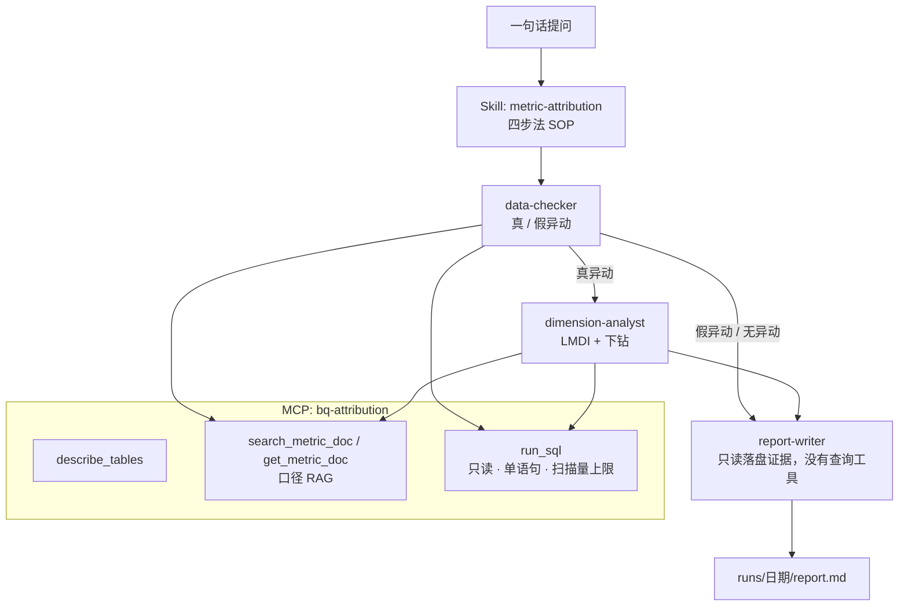

# 电商指标异动归因分析 + AI 归因助手

> 用 GA4 真实电商埋点数据，做埋点评审、搭建 3 层 12 个指标的指标体系与经营看板，沉淀「异动归因四步法」；
> 再用 Claude Code（Skill + MCP + RAG + Subagent）把这套方法自动化，并用 50 个注入异动评测助手的准确率。


**🔗 Tableau 看板**：待发布　**📄 案例报告**：[reports/](reports/)　**📊 评测结果**：[eval/results/](eval/results/)　**🧪 离线样例**：[examples/demo_run/report.md](examples/demo_run/report.md)

<!-- 看板发布后放截图： -->

## 核心结果（实测）

> 下表的数字要等我在 BigQuery 和 Claude Code 上实际跑完才填，**现在都是待实测**，不放任何估计值。

| 指标 | 结果 |
|---|---|
| 案例 1：节后 GMV 变化 | 待实测（其中转化率贡献 待实测） |
| AI 根因准确率（50 个用例） | v1 待实测 → vN 待实测 |
| 裁判与人工一致性（抽检 20 条） | Kappa = 待实测 |
| 单次排查耗时 | 人工 待实测 → AI 待实测 |
| 口径检索命中率（22 条问法） | hit@1 = 95.5%，hit@3 = 100%（`python eval/retrieval_eval.py`，问题集是我自己写的，规模小） |

## 数据

Google Merchandise Store GA4 公开数据集：BigQuery `bigquery-public-data.ga4_obfuscated_sample_ecommerce`，
2020-11-01 ~ 2021-01-31，事件数 待实测、用户数 待实测（`sql/01_dwd/00_smoke_test.sql`）。

这是官方混淆样本，部分取值是 `<Other>` / `(data deleted)` / `(not set)`，内部不完全一致，评审结论见 [docs/tracking_review.md](docs/tracking_review.md)。
另外 `traffic_source.medium` 是 **首次获客** 媒介，项目里的「渠道」都按这个口径。

## 项目结构

| 部分 | 内容 | 目录 |
|---|---|---|
| ① 指标体系与看板 | 埋点评审、清洗、12 个指标口径、汇总表、Tableau 看板 | [docs/](docs/)、[sql/](sql/)、[dashboard/](dashboard/) |
| ② 归因方法论 | 四步法、LMDI、维度下钻、案例报告 | [attribution/](attribution/)、[reports/](reports/) |
| ③ AI 归因助手 | Skill、三个 Subagent、自建 BigQuery MCP、口径 RAG | [.claude/](.claude/)、[mcp_server/](mcp_server/)、[CLAUDE.md](CLAUDE.md) |
| ④ 效果评测 | 50 个注入异动、Rubric、LLM 裁判、人工校准、版本对比 | [eval/](eval/) |

```
ecommerce-metric-attribution/
├── README.md / CLAUDE.md / .mcp.json / .env.example / requirements.txt / pyproject.toml / LICENSE
├── docs/
│   ├── metrics/                12 篇指标口径（同时是 RAG 知识库）
│   ├── metric_tree.md          指标树
│   ├── tracking_review.md      埋点评审报告
│   └── methodology.md          归因四步法
├── sql/
│   ├── 01_dwd/                 明细落表、清洗
│   ├── 02_dq_checks/           埋点评审 5 项检查
│   ├── 03_ads/                 汇总表、异动标记、漏斗长表、对数校验
│   └── 04_attribution/         排假、LMDI、下钻（参数化 @cur_dt / @base_dt）
├── attribution/                Python 归因库：metrics / anomaly_check / lmdi / drilldown / pipeline / report / synthetic
├── mcp_server/                 server.py（MCP 工具）、sql_guard.py（只读护栏）、retriever.py（口径检索）
├── .claude/
│   ├── settings.json
│   ├── skills/metric-attribution/   SKILL.md、methodology.md、report_template.md
│   └── agents/                      data-checker / dimension-analyst / report-writer
├── eval/
│   ├── inject/                 generate_cases.py、render_views.py（BigQuery 视图）、offline_inject.py
│   ├── cases/                  ground_truth.jsonl、retrieval_queries.jsonl、calm_dates.txt
│   ├── rubric.md / judge.py / run_eval.py / scoring.py / reference_numbers.py
│   ├── agreement.py / summarize.py / offline_baseline.py / retrieval_eval.py
│   ├── human_check.csv         人工抽检 20 条
│   └── results/                summary.csv（各版本对比）、offline_baseline/
├── scripts/                    bq_build.py、run_sql.py、export_dashboard_csv.py、verify_sql_local.py、demo_offline.py
├── tests/                      pytest
├── dashboard/  reports/  notebooks/  examples/demo_run/
└── .github/workflows/test.yml
```

## 方法

### 指标树
GMV = 访客数(UV) × 下单转化率(CR) × 客单价(AOV)，CR = 订单数 / UV，AOV = GMV / 订单数。
3 层 12 个指标，见 [docs/metric_tree.md](docs/metric_tree.md)，每个指标一篇口径文档：定义、业务含义、计算 SQL、可拆维度、**常见错误**、校验。

### 归因四步法（[docs/methodology.md](docs/methodology.md)）
1. **排除假异动**：事件结构（单一事件断崖且下游没跟着变 → 埋点丢失，并按 os 切片再查）、小时分布（截断 → 延迟）、维度新值（口径变更）、显著性（GMV 和各因子的周同比 z 值）。
2. **LMDI 因子拆解**：ΔGMV 无残差地分给 UV / CR / AOV，再往下拆到漏斗环节或「件数 × 件单价」。
3. **维度下钻**：可加指标直接分；比率指标拆「转化效应」和「结构效应」；单维 → 交叉，只有确实更集中才往下拆。
4. **结论与建议**：真/假异动、变化多大、主因、怎么办（对象、动作、验证指标、恢复标准）+ 局限。

SQL 版和 Python 版是同一套口径，`python scripts/verify_sql_local.py` 会把 BigQuery SQL 转成 DuckDB 方言，
在合成数据上逐项和 pandas 结果对比（汇总表 8 个字段、LMDI 三项贡献、CR 下钻效应全部一致）。

## AI 归因助手



几个设计点：
- **防编数字**：report-writer 没有任何查询工具，只能用前两步落盘的 JSON；Skill 要求每个数字都有 SQL 证据编号。
- **SQL 护栏**：`mcp_server/sql_guard.py` 先去掉注释和字符串再查关键字，拦多语句、DML/DDL、脚本语句；执行前 dry run 估算扫描量，超限直接拒绝。
- **口径 RAG**：12 篇短文档，用英文 token + 中文二元组 + BM25，按「## 小节」切块并给标题加权，加一张口语别名表。规模小，不上向量库，结果可解释；文档多了再换 embedding，接口不变。
- **评测可切换数据集**：`.mcp.json` 把 `BQ_DATASET` / `BQ_TABLE_PREFIX` 透传给 MCP，批量评测时每个用例自动查自己的视图。

## 快速开始

### A. 不需要 GCP：离线跑通全流程（几分钟）

```bash
git clone https://github.com/<your-github>/ecommerce-metric-attribution.git
cd ecommerce-metric-attribution
python -m venv .venv && .venv\Scripts\activate        # macOS / Linux：source .venv/bin/activate
pip install -r requirements.txt

pytest                                   # 单元测试
python scripts/verify_sql_local.py       # SQL 与 Python 口径一致性
python scripts/demo_offline.py           # 合成数据 + 注入异动 → examples/demo_run/
python eval/retrieval_eval.py            # 口径检索命中率
python eval/offline_baseline.py          # 50 个用例的规则基线（合成数据）
```

### B. BigQuery：在真实数据上建表

```bash
cp .env.example .env                     # 填 GCP_PROJECT_ID
gcloud auth application-default login
bq --location=US mk --dataset <你的项目>:ga4_attr     # 公共数据集在 US，自己的数据集也要建在 US

python scripts/bq_build.py --dry-run     # 先看扫描量
python scripts/bq_build.py               # 明细 → 清洗 → 汇总 → 对数校验
python scripts/run_sql.py sql/02_dq_checks/03_purchase_txn_consistency.sql   # 埋点评审各项
python scripts/run_sql.py sql/04_attribution/00_find_anomalies.sql          # 找异动点
python scripts/export_dashboard_csv.py   # 导出看板 CSV
```

### C. AI 归因助手

```bash
npm install -g @anthropic-ai/claude-code
claude                                   # 在仓库根目录启动，/mcp 确认 bq-attribution 已连接
> GMV 2020-12-28 为什么下降？
```

无交互运行：`claude -p "GMV 2020-12-28 为什么下降？基准期 2020-12-21。" --output-format json`

## 评测

真实异动没有标准答案，所以我在真实数据上 **注入已知原因的异动**，让助手去归因再打分。

| 类型 | 数量 | 注入方式 | 正确答案 |
|---|---|---|---|
| 流量下降 | 10 | 某人群 X% 用户当天全部事件消失 | UV 主导 + 定位人群 |
| 转化下降 | 10 | 某人群 X% 买家结算及之后的事件消失 | CR 主导 + 人群 + 结算环节 |
| 客单价变化 | 10 | 某人群订单金额 × (1 − X%) | AOV 主导 + 人群 |
| 埋点丢失 | 10 | 某个事件（可限定 iOS / Android）X% 不上报 | 判为数据问题，不给业务结论 |
| 数据延迟 | 5 | 当天 H 点之后的事件缺失 | 判为数据延迟 |
| 无异动对照 | 5 | 不注入 | 回答无显著异动 |

```bash
python eval/inject/generate_cases.py                   # 先把 00_find_anomalies.sql 筛出的平静日期写进 eval/cases/calm_dates.txt
python eval/inject/render_views.py --execute           # 在 ga4_eval 数据集建 150 个视图
python eval/reference_numbers.py                       # 标准数字 + 难度标注
python eval/run_eval.py --version v1 --note "基础 Skill"
python eval/judge.py --version v1                      # LLM 裁判
python eval/agreement.py --version v1 --sample 20      # 生成抽检清单 → 我盲打分 → 再跑一次算 Kappa
python eval/summarize.py --version v1 --note "基础 Skill"
```

打分（[eval/rubric.md](eval/rubric.md)）：根因准确 / 数字正确 / 建议可落地，各 0–2 分。
裁判拿的是 Python 算好的参考数字，只比对不自己算；另外 `eval/scoring.py` 直接比对助手落盘的 JSON 给一个结构化根因分，两者差很多的用例我会人工复核。

版本迭代每次只改一处，结果追加到 [eval/results/summary.csv](eval/results/summary.csv)：

| 版本 | 改动 | 根因准确率 | 数字 2 分率 | 建议 2 分率 | 假异动识别率 | 平均耗时 |
|---|---|---|---|---|---|---|
| v1 | 基础 Skill | 待实测 | | | | |
| v2 | 加「先查口径」硬规则 | 待实测 | | | | |
| v3 | 假异动判定阈值写进 Skill | 待实测 | | | | |
| v4 | report-writer 去掉查询工具 | 待实测 | | | | |

**离线规则基线**（[eval/results/offline_baseline/](eval/results/offline_baseline/)）：把四步法写死成规则，在合成数据上跑同样 50 个用例，
用来检查注入和打分逻辑本身没写错，也给助手一个下限参照。它不是助手的准确率，也不代表真实数据上的表现。

当前离线基线结果（`python eval/offline_baseline.py`，合成数据）：根因准确率 60%，去掉 22 个 hard 用例后 86%。
分类型看：延迟和对照组 100%，流量 80%，埋点丢失 60%（漏掉的都是只发生在单个 os、计数只有几十次的事件），
转化 40%、客单价 20%（大多是 hard：单日订单少，GMV 和 AOV 本身噪音就很大）。
这也是我把注入幅度从原计划的 10%–40% 提到 30%–70% 的原因。

## 本地验证状态

| 部分 | 状态 |
|---|---|
| Python 归因库、MCP 护栏、口径检索、评测打分 | `pytest` 全部通过 |
| SQL 口径 | 全部 SQL 用 sqlglot 按 BigQuery 方言解析通过；建表与归因 SQL 在 DuckDB 上与 pandas 结果逐项一致 |
| 在 BigQuery 真实数据上建表、埋点评审、案例分析 | 待实测（需要 GCP 项目） |
| Claude Code 端到端运行、50 用例评测、裁判一致性 | 待实测（需要 Claude Code 和 API Key） |
| Tableau 看板 | 待制作（CSV 导出脚本已就绪，可先用 `--offline` 搭布局） |

## 局限与后续

- 渠道是首次获客媒介，不是会话渠道；数据是混淆样本；只有 3 个月，没有真实年同比。
- 注入的异动是「单一原因」，真实情况常常是多因素叠加，所以我把 3 个真实案例作为验收集，和人工结论对照。
- 单日对比受随机波动影响很大（订单量小的时候尤其明显），注入效应小于 2 倍自然波动的用例标为 hard 单独统计。
- 后续：维度多了以后换 Adtributor / HotSpot 做根因定位；口径文档扩充后检索换成 embedding。

## License

MIT
