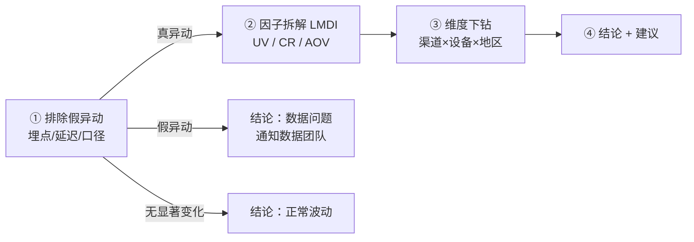

# 异动归因四步法

> 这份文档是我做归因分析的方法说明，也是 `.claude/skills/metric-attribution/methodology.md` 的完整版。
> 对应代码：`attribution/`（Python）和 `sql/04_attribution/`（SQL），两边口径一致，
> 用 `python scripts/verify_sql_local.py` 可以在本地验证。

## 0. 先定义「对比什么」

- 当前期 1 vs 基准期 0。单日默认对比 **上周同一天**（消除星期效应），也可以是一周 vs 前一周。
- 数据只有 3 个月，没有去年同期，所以不做年同比；报告里写清楚基准期是怎么选的。

## 1. 排除假异动

| 检查 | 怎么查 | 判定规则 | SQL / 代码 |
|---|---|---|---|
| 埋点丢失 | 当前期各事件量 vs 基准期 | 只有一个事件偏离（偏离 > max(其他事件典型偏离 × 3, 15%)），**且它下游的事件没有跟着变** | `01_event_mix.sql`、`01b_event_mix_by_os.sql`、`anomaly_check.event_mix_check` |
| 数据延迟 | 当天小时分布 | 从某个小时起之后每小时量都 < 基准期同小时的 5% | `02_hourly_distribution.sql`、`hourly_truncation_check` |
| 口径变化 | 维度取值新增 / 消失 | 只在一期出现且占比 ≥ 1% | `03_new_dim_values.sql`、`new_dim_values_check` |
| 显著性 | 当前期变化 vs 历史周同比分布 | \|z\| > 2 才算显著；历史不足 8 个点时用 ±10% | `00_find_anomalies.sql`、`significance_check` |

几点我自己的经验：
- 「下游没跟着变」这个条件很关键。转化真实下降时，结算、支付、下单会一起掉；
  埋点丢失时只有一个事件掉，下游反而正常（用户其实还在走流程）。
- 埋点问题常常只在某一端出现（例如只有 iOS 的加购不上报），全站汇总会被稀释，所以要按 os 再切一遍。
- 漏斗最后一步（purchase）单独下降时，结构上无法区分「支付故障」还是「下单埋点丢失」，
  我会把它当真异动继续拆，但在报告里把置信度降为 medium，并建议和订单系统对账。
- 判为假异动后 **不做业务归因**，直接出数据问题结论。

## 2. 因子拆解：LMDI

GMV = UV × CR × AOV（CR = 订单数 / UV，AOV = GMV / 订单数，恒等式严格成立）。

$$L(a,b) = \frac{a-b}{\ln a - \ln b}\ (a \ne b),\quad L(a,a)=a$$

$$\Delta GMV_{f} = L(GMV_1, GMV_0)\cdot\ln\frac{f_1}{f_0},\quad f \in \{UV, CR, AOV\}$$

三项之和严格等于 $GMV_1 - GMV_0$。为什么不直接看变化率：UV −10%、CR −10% 时 GMV 是 −19%，
不是 −20%，交叉项残差没法分给任何一个因子；LMDI 没有残差。

继续往下一层：
- CR = 浏览率 × 加购率 × 结算率 × 下单完成率 × 人均订单数 → 回答「转化掉在哪一步」
- AOV = 每单件数 × 件单价 → 回答「买得少了还是买得便宜了」

沿用同一个权重 $L(GMV_1, GMV_0)$，子因子贡献之和 = 父因子对 GMV 的贡献，报告里可以直接说「结算率下降让 GMV 少了 $X」。

限制：任何一个因子为 0 时无法取对数（例如某天订单数为 0），这时换更长的对比周期。

## 3. 维度下钻

### 方法 A：可加指标（GMV、订单数）
$\Delta GMV = \sum_i \Delta GMV_i$，按 $|\Delta GMV_i|$ 排序，算每个组合占总变化的比例。

### 方法 B：比率指标（CR、AOV）拆两种效应
总体 $CR = \sum_i w_i\, cr_i$（$w_i$ 为分组 UV 占比）：

$$\Delta CR = \underbrace{\sum_i \bar w_i\,\Delta cr_i}_{\text{转化效应}} + \underbrace{\sum_i \overline{cr}_i\,\Delta w_i}_{\text{结构效应}}$$

两种效应对应的动作完全不同：转化效应是「这群人自己变差了」→ 查产品体验；
结构效应是「低转化人群占比变高了」→ 查流量结构 / 投放。AOV 同理，权重换成订单占比。

### 组合搜索顺序
1. 单维度（channel / device / country）各看一遍，选 Top1 贡献占比最高的维度；
2. 在该维度上逐个加维度做交叉，**新一层 Top1 仍然集中、且不低于上一层 Top1 的 80%** 才往下走；
3. 最多三维，只保留 UV 占比 ≥ 1% 的组合（防小样本噪音）；
4. 「集中」= Top1 ≥ 50% 或 Top3 ≥ 80%。

第 2 条是为了避免过度拆分：如果问题只在 mobile 整体，就不应该硬拆成 mobile × 某个渠道。

维度少，穷举 + 剪枝就够了；维度多时可以换 Adtributor（JS 散度选维度）或 HotSpot 这类根因定位算法。

## 4. 结论与建议

结论回答四个问题：
1. 是不是真异动？
2. 变化有多大？（ΔGMV、%，换算成「每天少卖 $X」）
3. 主要因为什么？（因子贡献占比 + 下钻定位的人群 + 漏斗环节）
4. 怎么办？建议要写明 **谁、做什么、看什么指标验证、恢复到多少算修复**。

- ❌「提升移动端用户体验」
- ✅「移动端自然流量的结算率下降 X pp，建议检查 12-2X 移动端结算页改版 / 支付方式，按天监控该人群结算率，恢复到基准期 X% 视为修复」

最后一定写「局限」：渠道是首次获客渠道、数据是混淆样本、单日对比受随机波动影响、节后回落本身可能是季节性……
