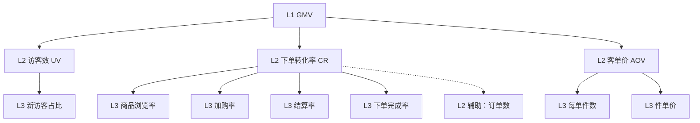

# 指标树（3 层 12 个指标）

核心恒等式：**GMV = 访客数(UV) × 下单转化率(CR) × 客单价(AOV)**，口径统一用「订单口径」。

| # | 层级 | 指标 | metric_id | 定义 |
|---|---|---|---|---|
| 1 | L1 | GMV | gmv | 清洗后下单金额之和 |
| 2 | L2 | 访客数 UV | uv | 当日去重 user_pseudo_id |
| 3 | L2 | 订单数 | orders | 当日去重 transaction_id |
| 4 | L2 | 下单转化率 | conversion_rate | 订单数 / UV |
| 5 | L2 | 客单价 | aov | GMV / 订单数 |
| 6 | L3 | 新访客占比 | new_user_ratio | first_visit 用户 / UV |
| 7 | L3 | 商品浏览率 | view_rate | view_item 用户 / UV |
| 8 | L3 | 加购率 | add_to_cart_rate | add_to_cart 用户 / view_item 用户 |
| 9 | L3 | 结算率 | checkout_rate | begin_checkout 用户 / add_to_cart 用户 |
| 10 | L3 | 下单完成率 | purchase_completion_rate | 下单用户 / begin_checkout 用户 |
| 11 | L3 | 每单件数 | items_per_order | 商品件数 / 订单数 |
| 12 | L3 | 件单价 | avg_item_price | GMV / 商品件数 |

拆分维度：渠道（首次获客媒介）× 设备 × 国家（前 10 国，其余归 other）。
每个指标的完整口径见 [docs/metrics/](metrics/)。
